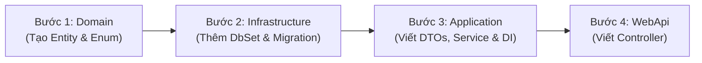

# HƯỚNG DẪN PHÁT TRIỂN MODULE BACKEND
## Dự án: University Centralized Document Management System (UCDMS)
*Dành cho các thành viên phát triển Backend (Thành viên 2, Thành viên 3) và tích hợp Frontend (Thành viên 4, Thành viên 5)*

---

## 1. TỔNG QUAN KIẾN TRÚC & QUY CHUẨN KỸ THUẬT

Hệ thống Backend được xây dựng theo kiến trúc **Clean Architecture** trên nền tảng **ASP.NET Core 10 Web API** và **Entity Framework Core 10 (SQL Server)**.

```
D:\UniversityDocumentManagement_backend\
├── src/
│   ├── Domain/                 # Entity, Enum, BaseEntity, Domain Exceptions (Không phụ thuộc tầng ngoài)
│   ├── Application/            # DTOs, UseCases/Services, Interfaces (Phụ thuộc Domain)
│   ├── Infrastructure/         # EF Core, SQL Server, JWT, File Storage, SignalR (Triển khai Interface)
│   └── WebApi/                 # Controllers, Middlewares, Program.cs (Điểm khởi chạy hệ thống)
└── tests/
    ├── Domain.Tests/
    ├── Application.Tests/
    └── WebApi.Tests/
```

### Quy chuẩn dữ liệu API trả về (Thống nhất Frontend - Backend):
Mọi API đều phải bọc dữ liệu qua lớp `ApiResponse<T>`:
```json
{
  "success": true,
  "message": "Thông báo kết quả",
  "data": { ... },
  "errors": null
}
```

---

## 2. HƯỚNG DẪN KHỞI CHẠY LẦN ĐẦU (GETTING STARTED)

1. **Clone repository về máy:**
   ```bash
   git clone <URL_REPO_GITHUB>
   git checkout develop
   ```
2. **Mở Solution:** Mở file `UniversityDocumentManagement.slnx` bằng Visual Studio 2022+ (hoặc Rider / VS Code).
3. **Cấu hình chuỗi kết nối Database:** Kiểm tra file `src/WebApi/appsettings.json`:
   ```json
   "ConnectionStrings": {
     "DefaultConnection": "Server=(localdb)\\mssqllocaldb;Database=UniversityDocumentManagementDb;Trusted_Connection=True;MultipleActiveResultSets=true;TrustServerCertificate=True"
   }
   ```
4. **Chạy ứng dụng (F5):**
   * Hệ thống sẽ **tự động kiểm tra Migration và nạp dữ liệu mẫu (Seed Data)** gồm các Roles mặc định, Khoa mẫu và tài khoản Quản trị viên.
5. **Truy cập tài liệu API (Scalar API Reference):**
   * Mở trình duyệt vào link: **`https://localhost:7028/scalar/v1`**
   * Tài khoản Admin mặc định:
     * **Email:** `admin@ucdms.edu.vn`
     * **Mật khẩu:** `Admin@123456`

---

## 3. QUY TRÌNH 4 BƯỚC CHUẨN ĐỂ PHÁT TRIỂN MỘT TÍNH NĂNG MỚI

Khi bạn được phân công làm một module mới (ví dụ: `Documents`, `IntakeSessions`, `Approvals`), hãy làm theo đúng 4 bước sau:



---

### BƯỚC 1: TẠO ENTITY & ENUM TRONG `src/Domain`
1. Nếu có trạng thái mới (Status), tạo Enum trong `src/Domain/Enums/` (Lưu ý: Luôn đặt `public enum`).
2. Tạo Entity trong `src/Domain/Entities/`, kế thừa từ `AuditableEntity<Guid>` để có sẵn `Id`, `CreatedAt`, `UpdatedAt`, `IsDeleted`:
   ```csharp
   using Domain.Common;

   namespace Domain.Entities;

   public class Document : AuditableEntity<Guid>
   {
       public string Title { get; set; } = string.Empty;
       public string DocumentNumber { get; set; } = string.Empty;
       // ... các thuộc tính khác
   }
   ```

---

### BƯỚC 2: CẤU HÌNH DATABASE TRONG `src/Infrastructure`
1. Khai báo `DbSet` mới vào **`src/Application/Common/Interfaces/IApplicationDbContext.cs`**:
   ```csharp
   DbSet<Document> Documents { get; }
   ```
2. Khai báo `DbSet` và Fluent API (nếu có khóa ngoại/index) vào **`src/Infrastructure/Persistence/ApplicationDbContext.cs`**:
   ```csharp
   public DbSet<Document> Documents => Set<Document>();
   ```
3. Mở Terminal tại thư mục gốc chạy lệnh tạo Migration tích lũy:
   ```powershell
   dotnet ef migrations add AddDocumentModule --project src/Infrastructure --startup-project src/WebApi
   dotnet ef database update --project src/Infrastructure --startup-project src/WebApi
   ```

---

### BƯỚC 3: XÂY DỰNG NGHIỆP VỤ TRONG `src/Application`
1. Mở thư mục tương ứng trong `src/Application/Features/<Tên_Module>/`.
2. Tạo các file DTO (Request / Response):
   * Ví dụ: `CreateDocumentRequest`, `UpdateDocumentRequest`, `DocumentDto`.
3. Tạo Interface Service:
   * Ví dụ: `IDocumentService.cs`.
4. Tạo Class triển khai Service:
   * Ví dụ: `DocumentService.cs` kế thừa `IDocumentService`.
   * **Lưu ý:** Luôn thêm `using Microsoft.EntityFrameworkCore;` để dùng các hàm bất đồng bộ (`ToListAsync`, `FirstOrDefaultAsync`, `Include`...).
   * **Xử lý lỗi:** Nếu không tìm thấy dữ liệu, hãy `throw new NotFoundException("Tài liệu", id);` (Middleware toàn cục sẽ tự động bắt và trả về HTTP 404 chuẩn JSON).
5. Đăng ký Service vào **`src/Application/DependencyInjection.cs`**:
   ```csharp
   services.AddScoped<IDocumentService, DocumentService>();
   ```

---

### BƯỚC 4: VIẾT CONTROLLER TRONG `src/WebApi`
1. Tạo Controller trong `src/WebApi/Controllers/<Tên_Module>Controller.cs`:
   * Kế thừa `ControllerBase`.
   * Thêm attribute `[ApiController]`, `[Route("api/v1/<tên_tính_năng>")]`.
   * Thêm `[Authorize]` nếu cần đăng nhập, hoặc `[Authorize(Roles = SystemRoles.Admin)]` nếu cần phân quyền.
2. Inject Service vừa viết vào Constructor và viết các Action method (`HttpGet`, `HttpPost`, `HttpPut`, `HttpDelete`).
3. Chạy ứng dụng và mở `/scalar/v1` để kiểm thử ngay.

---

## 4. PHÂN CÔNG NHIỆM VỤ CHI TIẾT CHO CÁC THÀNH VIÊN TIẾP THEO

### 👨‍💻 THÀNH VIÊN 2 (Backend Document & QR Code)
* **Nhánh làm việc:** `feature/qr-code`, `feature/document-management`
* **Nhiệm vụ phụ trách:**
  1. **QR Code Intake Module:**
     * Entities: `IntakeSession`, `IntakeConnection`, `IntakeFile`, `IntakeHistory`.
     * Tạo mã QR Code có thời hạn (dùng thư viện `QRCoder` đã cài sẵn ở Infrastructure).
     * API tạo phiên quét (`POST /api/v1/intake/sessions`).
     * API điện thoại kết nối và tải file lên (`POST /api/v1/intake/sessions/{id}/upload`).
     * API máy trạm kiểm tra và xác nhận tiếp nhận file (`POST /api/v1/intake/files/{id}/confirm`).
  2. **File Storage Service:**
     * Lưu trữ file an toàn bên ngoài web root (theo đường dẫn cấu hình `FileStorageSettings:StoragePath`).
     * Tính toán mã SHA-256 Checksum, kiểm tra định dạng và dung lượng file cho phép.
  3. **Quản lý Tài liệu & Phiên bản:**
     * Entities: `Document`, `DocumentVersion`, `DocumentCategory`, `Folder`, `Tag`, `DocumentTag`.
     * API CRUD tài liệu, quản lý thư mục, danh mục và lịch sử các phiên bản tệp.

---

### 👨‍💻 THÀNH VIÊN 3 (Backend Workflow, Realtime & Reports)
* **Nhánh làm việc:** `feature/approval-workflow`, `feature/signalr-realtime`, `feature/audit-log`
* **Nhiệm vụ phụ trách:**
  1. **Realtime SignalR Hub:**
     * Tạo Hub tiếp nhận tại `src/WebApi/Hubs/IntakeHub.cs`.
     * Khi điện thoại quét QR thành công hoặc upload file thành công, SignalR tự động đẩy sự kiện đến máy trạm tiếp nhận theo thời gian thực (không cần F5).
  2. **Approval Workflow (Quy trình duyệt tài liệu):**
     * Entities: `Approval`, `ApprovalHistory`.
     * API trình duyệt tài liệu (`/submit`), phê duyệt (`/approve`), từ chối (`/reject` kèm lý do).
  3. **Document Permissions:**
     * Entity `DocumentPermission`: Phân quyền xem, chỉnh sửa, tải xuống tài liệu theo User hoặc Department.
  4. **Audit Logs & Notifications:**
     * Tự động ghi vết hoạt động vào bảng `AuditLogs`.
     * API Thông báo (`/api/v1/notifications`).
     * API Thống kê báo cáo Dashboard (`/api/v1/reports/dashboard`).

---

## 5. QUY CHUẨN LÀM VIỆC VỚI GIT & GITHUB (BẮT BUỘC)

* **Nhánh chính:** `main` (không commit/push trực tiếp vào đây).
* **Nhánh phát triển chung:** `develop`.
* **Quy trình làm việc hàng ngày:**
  ```bash
  # 1. Cập nhật code mới nhất từ nhánh develop
  git checkout develop
  git pull origin develop

  # 2. Tạo nhánh tính năng riêng của bạn
  git checkout -b feature/<tên-tính-năng>

  # 3. Lập trình và commit theo chuẩn conventional commits
  git add .
  git commit -m "feat(document): implement document upload service"

  # 4. Đẩy nhánh lên GitHub và tạo Pull Request vào develop
  git push origin feature/<tên-tính-năng>
  ```
* **Quy chuẩn thông điệp Commit:**
  * `feat:` Tính năng mới (ví dụ: `feat(station): add qr station api`)
  * `fix:` Sửa lỗi (ví dụ: `fix(auth): correct token expiry calculation`)
  * `refactor:` Tối ưu/tái cấu trúc code (không đổi tính năng)
  * `docs:` Cập nhật tài liệu
  * `test:` Viết thêm Unit Test

---
*Mọi thắc mắc về kiến trúc lõi vui lòng liên hệ Backend Leader.*
